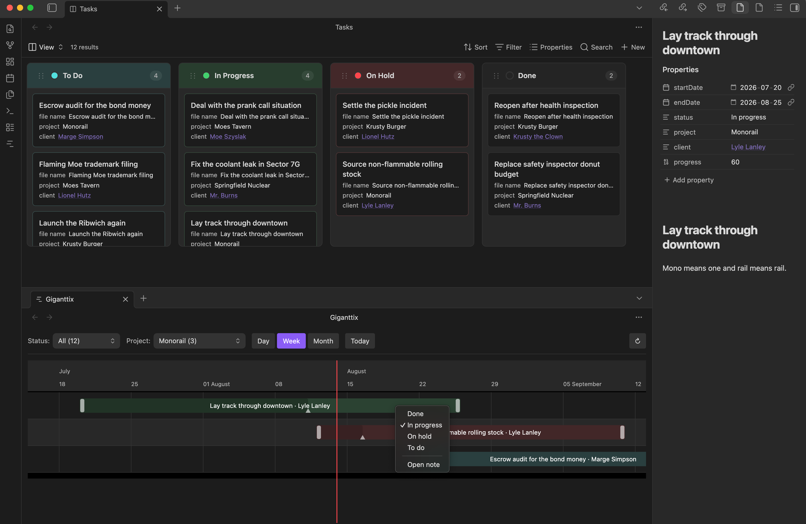
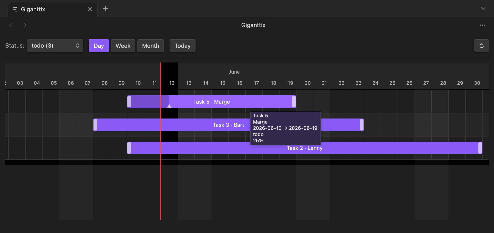
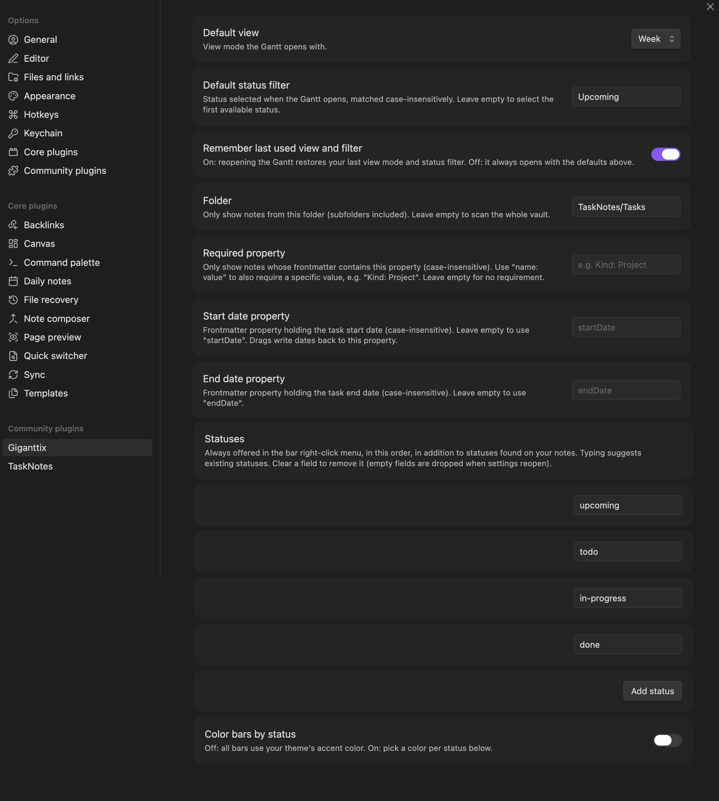

# Giganttix
Visualise your task notes as a draggable Gantt chart in Obsidian

Giganttix scans your vault for notes with date frontmatter and renders them as an interactive timeline. Each note is one bar. Drag a bar to reschedule the task & the new dates are written back to the note's frontmatter. Click a bar to open the note in a new tab, right-click it to change its status.

Originally built to be viewed with a kanban board (external plugin or upcoming official kanban base core plugin).

 

## How it works

Add dates to any note's frontmatter and it appears on the chart:

```yaml
---
startDate: 2026-06-05
endDate: 2026-06-30
status: In progress
project: Springfield Nuclear
client: "[[Moe's Tavern]]"
progress: 40
---
```

| Field | Required | Notes |
| --- | --- | --- |
| `startDate` | yes* | `YYYY-MM-DD` |
| `endDate` | yes* | same formats |
| `status` | no | powers the status filter and the right-click menu |
| `project` | no | powers the project filter (set the property name in settings) |
| `client` | no | shown after the task name |
| `progress` | no | 0–100, rendered as a darker segment inside the bar |


## Features

- **Drag to reschedule** : move or resize a bar; frontmatter updates atomically
- **Drag the progress handle** : hover a bar and drag the small handle to set % complete, written to `progress`
- **Click a bar** to open its note in a new tab (focuses the existing tab if it's already open)
- **Right-click a bar** to change its status without leaving the chart, or open the note
- **Day, Week & Month views**
- **Today button** to jump back to the current date
- **Status filter** built from your actual status values, with an "All" option to see everything at once
- **Project/client filter** : set a project property in settings and a second dropdown appears to filter by project
- **Custom statuses** : define your own status list in settings, with suggestions pulled from your notes as you type
- **Custom date properties** : use any frontmatter properties for start and end dates
- **Tooltips** : hover any bar for full name, client, dates, status, and progress
- **Weekend shading** in Day view
- **Scope your tasks** : limit the chart to a folder and/or require a frontmatter property (e.g. only notes with a `projects` property)
- **Status colors** : keep the theme accent color, or assign a color per status in settings



## Usage

Open the chart from the ribbon icon or the command palette.

## Settings

| Setting | What it does |
| --- | --- |
| Default view | Day, Week or Month on open |
| Default status filter | Status selected on open (case-insensitive); empty = first available |
| Remember last used view and filter | On: reopening restores your last state. Off: always open with the defaults |
| Folder | Only show notes from this folder (subfolders included); empty = whole vault |
| Required property | Only show notes that have this frontmatter property, e.g. `projects` |
| Start date property | Frontmatter property read for the start date; empty = `startDate` |
| End date property | Frontmatter property read for the end date; empty = `endDate` |
| Project property | Frontmatter property to group tasks by project; empty = no project filter |
| Statuses | Statuses always offered in the right-click menu, in your order |
| Color bars by status | Off: theme accent color. On: per-status color pickers |



## Installation

**Community plugins:** Settings → Community plugins → Browse → search "Giganttix".


## Notes and limitations

- Desktop only for now.


## Acknowledgements

Built with TypeScript and esbuild on top of [Frappe Gantt](https://github.com/frappe/gantt) (MIT). Developed with [Claude Cowork](https://claude.com) (Anthropic).

## License

[MIT](LICENSE)
